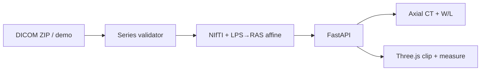

# DICOM Portfolio

Educational interview demo: ingest a CT series, validate geometry, convert DICOM (LPS) → NIfTI (RAS), and view axial slices beside a clip/measure bone mesh.

**Intended use:** portfolio / teaching only. **Not SaMD.** Not for diagnosis, treatment, or clinical decisions.

## One-command demo

```bash
docker compose up --build
```

Open **http://localhost:8080** → **Load synthetic sample** (or **Load TCIA sample** if you have run the download script on the host). API also on http://localhost:8000/docs.

Requires Docker. Fixtures are bind-mounted from `./fixtures`.

## Architecture



| Layer | Stack |
|-------|--------|
| API | Python 3.12, FastAPI, pydicom, nibabel, numpy |
| Web | React, TypeScript, Vite, Three.js (R3F + drei) |
| Demo | Docker Compose: `api` + nginx `web` |

Regulatory artifacts (requirements, traceability, risk, SOUP, IEC 62304 note): [docs/regulatory/](docs/regulatory/). Build plan: [docs/PLAN.md](docs/PLAN.md).

## Local development

**Backend**

```bash
cd backend
uv sync --group dev
uv run python ../scripts/generate_fixtures.py
uv run python ../scripts/generate_mesh.py
uv run pytest -v
uv run uvicorn app.main:app --reload --port 8000
```

**Frontend** (Vite proxies `/api` → `:8000`)

```bash
cd frontend
npm install
npm run dev
```

Open http://localhost:5173.

**Optional TCIA sample** (CC BY 3.0 phantom CT):

```bash
uv run python scripts/download_tcia_sample.py
```

Then use **Load TCIA sample** in the UI, or `POST /studies/demo/tcia`.

### API map

| Method | Path | Purpose |
|--------|------|---------|
| GET | `/health` | Liveness |
| POST | `/studies?deidentify=true` | Upload DICOM ZIP → validate → NIfTI |
| POST | `/studies/demo/{synthetic\|tcia}` | Load fixture without upload |
| GET | `/studies/{id}` | Metadata + validation issues |
| GET | `/studies/{id}/slices/{z}` | Axial PNG (window/level query params) |
| GET | `/studies/{id}/nifti` | Download `.nii.gz` |
| GET | `/meshes/bone` | Demo GLB (also shipped under `frontend/public`) |

## Interview talking points

1. **Tags → stack** — CT as a series ordered by IPP along IOP normal; why mixed `SeriesInstanceUID` is fatal.
2. **LPS vs RAS** — DICOM patient frame is LPS; NIfTI expects RAS; show the explicit affine flip and the round-trip pytest.
3. **Classic orientation bug** — forgetting the LPS→RAS sign change flips laterality; risk register `R-01`.
4. **Validation** — gaps, inconsistent spacing/IOP, mixed series; open a bad fixture and the issue codes.
5. **Viewer** — window/level for HU; mesh clip + distance with an explicit units disclaimer (mesh is not co-registered patient mm).
6. **Regulated software habits** — requirements ↔ tests in `traceability.csv`, SOUP list, IEC 62304 class discussion, and why this repo is **not** a device.

## Known limitations

- Axial slices only (no full MPR / coronal / sagittal reformats).
- Mesh is a demo fixture, not a segmentation co-registered to the CT.
- No OCR for burned-in PHI pixels (tag blanking only).
- No Cypress/E2E; pytest + manual Docker smoke path.
- TCIA sample is optional and gitignored when large; synthetic fixtures always ship.

## Anonymization notes

- Ingest supports `deidentify=true` (default): blanks PatientName, PatientID, and related PHI tags listed in `backend/app/deid.py`.
- Synthetic fixtures contain no real PHI.
- TCIA CC-Radiomics-Phantom is public research data under [CC BY 3.0](https://creativecommons.org/licenses/by/3.0/); still de-identify on ingest for demo hygiene.
- Burned-in pixel text is **not** removed.

### TCIA provenance

- Collection: [CC-Radiomics-Phantom](https://doi.org/10.7937/K9/TCIA.2017.zuzrml5b)
- Default download keeps a mid-stack window (~48 slices) for a snappy demo (`--max-slices 0` keeps all)
